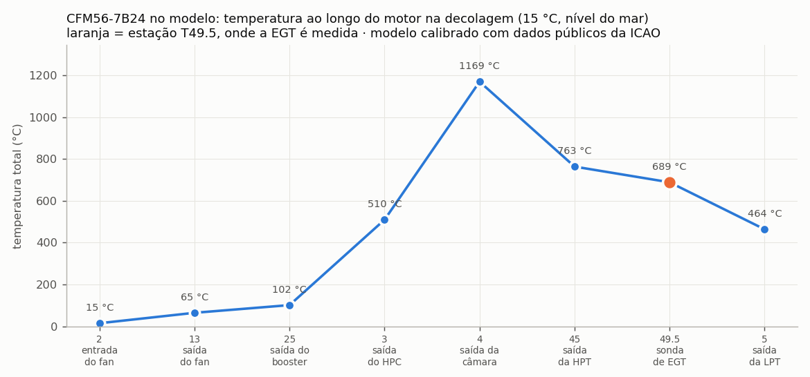
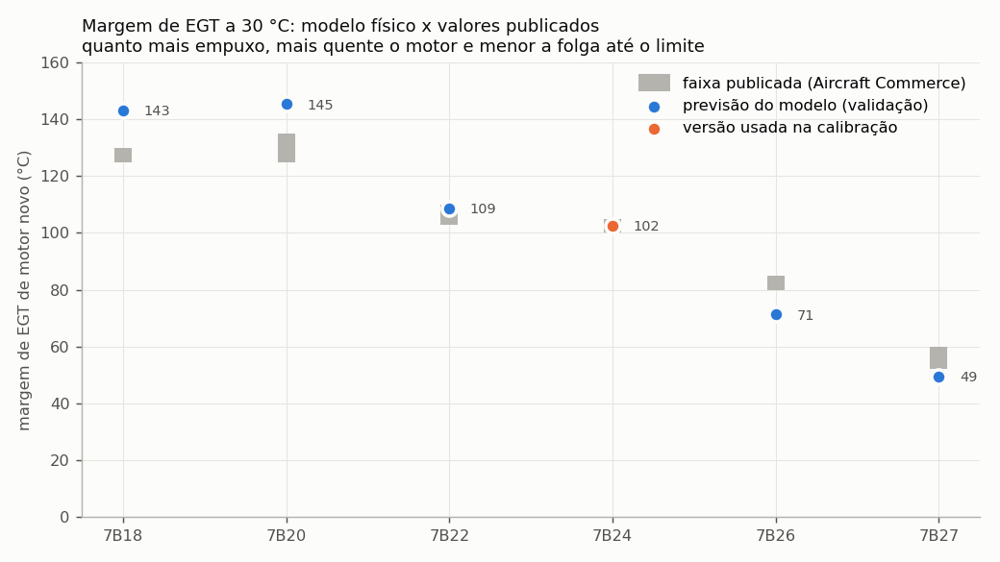
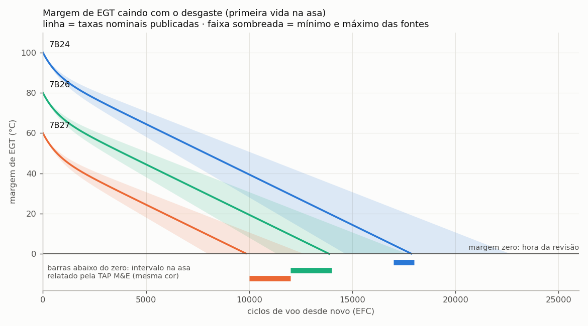
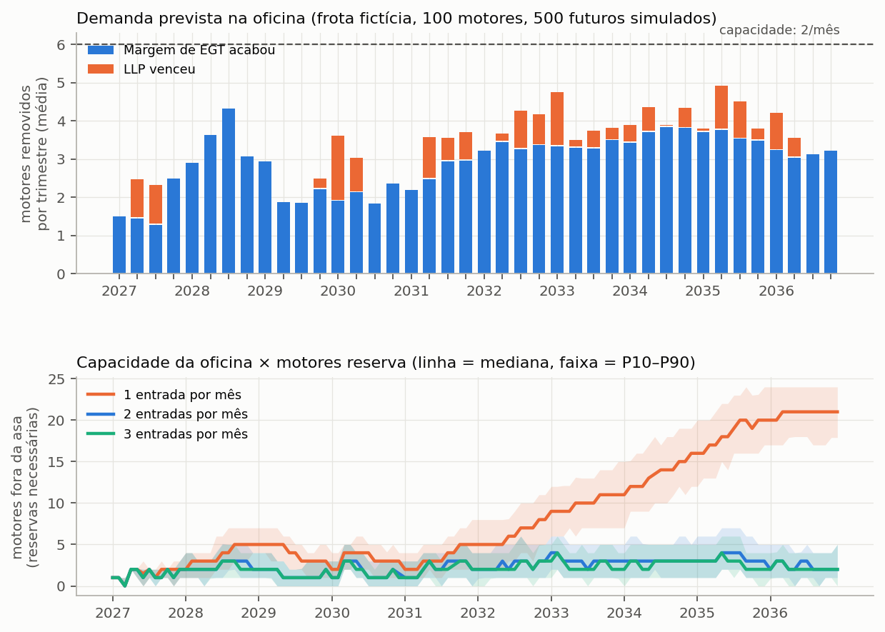

# Planejador de Revisão do CFM56-7B

Projeto de estudo sobre **quando um motor CFM56-7B precisa ir para a oficina (shop visit)**,
usando apenas dados públicos e um modelo físico do motor em Python.

**🌐 Site interativo:** [asafeferreira.github.io/planejador-revisao-cfm56](https://asafeferreira.github.io/planejador-revisao-cfm56/)

O CFM56-7B equipa o Boeing 737 Next Generation (737-600/700/800/900). A principal medida que as
companhias aéreas usam para decidir a revisão é a **margem de EGT**: a folga entre a temperatura
do gás de escape do motor e o limite que ele não pode passar. Com o desgaste, essa folga diminui.

> **Aviso:** só uso dados públicos (ICAO/EASA, ficha de certificação da CAA do Reino Unido,
> teses e artigos publicados). O desgaste e a
> frota são **simulados**. Nenhum dado da GE, da CFM ou da GE Celma é usado neste projeto.

## Plano

| Etapa | O que faz | Status |
|---|---|---|
| 1 | Carregar os dados públicos do CFM56-7B (banco de emissões da ICAO) | ✅ |
| 2 | Modelo termodinâmico do motor (fan, booster, HPC, câmara, HPT, LPT), calibrado com os dados da ICAO | ✅ |
| 3 | Simulação de desgaste do HPC e da HPT e queda da margem de EGT ao longo dos ciclos | ✅ |
| 4 | Planejamento de oficina: quando cada motor de uma frota fictícia vai precisar de revisão (margem de EGT e LLPs) | ✅ |
| 5 | Site interativo para leigos, com o simulador rodando no navegador | ✅ |

Para entender a física do motor, veja [docs/ciclo-do-motor.md](docs/ciclo-do-motor.md).

## Como rodar

```bash
python3 -m venv .venv
.venv/bin/pip install -r requirements.txt
.venv/bin/python src/01_carregar_icao.py
.venv/bin/python src/02_modelo_ciclo.py
.venv/bin/python src/03_desgaste.py
.venv/bin/python src/04_planejamento.py
.venv/bin/python src/05_exportar_site.py   # gera site/dados.json
node site/teste_simulador.mjs              # confere JavaScript = Python
python3 -m http.server -d site 8000        # abrir http://localhost:8000
```

## Dados da etapa 1

O banco de emissões da ICAO traz, para 33 versões do CFM56-7B, o empuxo de decolagem, a razão de
bypass, a razão de pressão e o **consumo de combustível medido em banco de provas** em 4 regimes:
decolagem (100% do empuxo), subida (85%), aproximação (30%) e marcha lenta (7%).

| Versão | Empuxo (kN) | Bypass | Razão de pressão | Consumo na decolagem (kg/s) | TSFC (lb/lbf·h) |
|---|---|---|---|---|---|
| CFM56-7B18 | 86,7 | 5,5 | 21,6 | 0,854 | 0,348 |
| CFM56-7B20 | 91,6 | 5,4 | 22,6 | 0,913 | 0,352 |
| CFM56-7B22 | 101,0 | 5,3 | 24,4 | 1,021 | 0,357 |
| CFM56-7B24 | 107,7 | 5,2 | 25,8 | 1,103 | 0,362 |
| CFM56-7B26 | 117,0 | 5,1 | 27,6 | 1,221 | 0,368 |
| CFM56-7B27 | 121,4 | 5,0 | 28,6 | 1,284 | 0,373 |

O CFM56-7B é um único projeto de motor oferecido em várias classes de empuxo. Quanto mais empuxo,
mais o núcleo é "apertado": a razão de pressão sobe, o bypass cai um pouco e o consumo
específico (TSFC) aumenta.

## Etapa 2: modelo termodinâmico

[src/motor.py](src/motor.py) calcula o motor estação por estação (fan, booster, HPC, câmara,
HPT, LPT e bocais) com conservação de energia e relações de gás ideal, no mesmo estilo dos
livros-texto de propulsão e da biblioteca pyCycle da NASA.

**Dados de certificação usados** (ficha UK.TC.E.00104 da CAA, 2024, e Aircraft Commerce):

- A EGT é medida na estação **T49.5**, no bocal do 2º estágio da turbina de baixa.
- O limite exibido na cabine é **950 °C**, mas o controle eletrônico soma um "shunt" (+30 °C nas
  versões de câmara simples) ao valor medido. Por isso o limite **real** varia por versão:
  884 °C no 7B20, 908 °C no 7B24 e 920 °C no 7B26/7B27.
- O empuxo de decolagem é mantido constante até **30 °C** (o "corner point"). A margem de EGT é
  definida nessa condição.

**Método:**

1. Para cada versão, o modelo acha a temperatura na saída da câmara (T4), a razão de pressão do
   fan e a vazão de ar que reproduzem o **empuxo e o consumo medidos pela ICAO**.
2. O ponto de decolagem é levado para um dia de 30 °C por semelhança (parâmetros corrigidos): com
   o empuxo constante, todas as temperaturas se multiplicam por θ = T / 288,15 K.
3. **Calibração com uma versão só (7B24):** um deslocamento de EGT faz o modelo bater com a margem
   publicada para o 7B24 novo (100–105 °C).
4. **Validação nas outras 5 versões:** o modelo prevê a margem de cada uma, e a previsão é
   comparada com os valores publicados, que ele não viu.

**Resultados:**

| Versão | Vazão de ar (kg/s) | Razão do fan | T4 (K) | Margem publicada (°C) | Margem prevista (°C) |
|---|---|---|---|---|---|
| 7B18 | 323 | 1,51 | 1317 | 125–130 | 143 |
| 7B20 | 328 | 1,55 | 1351 | 125–135 | 145 |
| 7B22 | 342 | 1,62 | 1404 | 103–110 | 109 |
| 7B24 (calibração) | 350 | 1,68 | 1442 | 100–105 | 102 |
| 7B26 | 360 | 1,77 | 1500 | 80–85 | 71 |
| 7B27 | 363 | 1,82 | 1529 | 52–60 | 49 |

Erro médio nas 5 versões de validação: **10 °C**. O modelo reproduz, só com física, a tendência
que as oficinas observam: quanto mais empuxo, mais quente o motor e menor a margem de EGT.




**Sensibilidade às hipóteses** (erro nas 5 versões de validação):

| Ar de refrigeração | Ajuste de eficiência | Erro médio | Pior erro |
|---|---|---|---|
| 7% | +0,02 | 20 °C | 39 °C |
| **7%** | **+0,03 (usado)** | **10 °C** | **16 °C** |
| 7% | +0,04 | 7 °C | 12 °C |
| 10% | +0,03 | 14 °C | 24 °C |
| 10% | +0,04 | 9 °C | 14 °C |

Em todas as combinações, a tendência entre as versões se mantém.

**Limitações (importante):**

- O modelo é 0-D, sem mapas de componentes. Ele serve para **tendências e variações**, e não
  para o valor absoluto de temperatura. O deslocamento de calibração (+67 °C na EGT) mostra que a
  T4 do modelo provavelmente está abaixo da real: posição da sonda, esquema de refrigeração e
  propriedades dos gases são simplificados.
- As eficiências dos componentes não são publicadas. Usei valores de livro-texto mais um ajuste
  único (+0,03), e a tabela de sensibilidade mostra o efeito dessa escolha.
- A razão entre as velocidades dos jatos (0,8) é uma regra de projeto de livro-texto, e não um
  dado do CFM56-7B.

## Etapa 3: desgaste e margem de EGT ao longo dos ciclos

**A) Taxas de troca (física).** Com o modelo da etapa 2, cada componente do 7B24 perde 1 ponto de
eficiência, e o FADEC mantém o empuxo. O resultado é a tabela que a indústria usa na análise de
caminho do gás (gas path analysis), para descobrir qual componente se desgastou:

| Componente (−1 ponto de eficiência) | EGT | T4 | Consumo |
|---|---|---|---|
| HPC | +5,4 °C | +11,2 K | +0,78% |
| HPT | +5,2 °C | +5,5 K | +0,74% |
| Fan | +5,0 °C | +6,7 K | +0,75% |
| LPT | +5,4 °C | +5,8 K | +0,78% |
| Booster | +1,0 °C | +1,5 K | +0,10% |

Um detalhe útil para diagnóstico: o HPC desgastado sobe a T4 **duas vezes mais** que a HPT para o
mesmo aumento de EGT. Por isso, olhar só a EGT não basta para saber qual peça trocar.

**B) Desgaste ao longo dos ciclos.** A perda de margem segue as taxas que a TAP M&E relatou à
Aircraft Commerce: 11–15 °C nos primeiros 1.000 ciclos (amaciamento, quando as folgas das pontas das
pás aumentam) e depois 4–6 °C a cada 1.000 ciclos (erosão lenta). Em [src/desgaste.py](src/desgaste.py):

    perda(n) = A × (1 − e^(−n/700)) + taxa × n      com A ≈ 10,5 °C e taxa = 5 °C / 1.000 ciclos

**Validação: ciclos na asa até a margem acabar (primeira vida)**

| Versão | Margem nova | Previsto (faixa) | Publicado (TAP M&E) |
|---|---|---|---|
| 7B24 | 100 °C | **17.900** (14.700–22.700) | 17.000–18.000 |
| 7B26 | 80 °C | **13.900** (11.400–17.700) | 12.000–14.000 |
| 7B27 | 60 °C | **9.900** (8.000–12.700) | 10.000–12.000 |



> **Atenção:** essa tabela confere se a curva é **coerente** com a fonte, já que a TAP calculou os
> intervalos a partir das mesmas margens e taxas. Ela não é uma validação independente. A parte
> independente é a cadeia completa, logo abaixo.

**Cadeia completa:** usando a margem nova prevista pela física da etapa 2 (em vez da margem da
fonte), o 7B24 dá 18.400 ciclos e o 7B26 dá 12.200, ambos dentro do publicado. O 7B27 dá 7.800,
abaixo do publicado, porque a física previu 49 °C de margem contra 55–60 °C das fontes.

**Segunda vida (depois da revisão):** o 7B24 bate (12.900 previstos contra 12.000–13.000
publicados). No 7B26 e no 7B27, as margens restauradas da tabela do nº 58 (42–48 °C) não conseguem
explicar os intervalos publicados no mesmo artigo (9.000–12.000). O nº 87 (2013) dá **60–68 °C**
para o 7B26 restaurado, e com esse valor o modelo prevê **10.700 ciclos**, dentro do publicado. Ou
seja, a verificação cruzada indica que a tabela do nº 58 subestima as margens restauradas.

## Etapa 4: planejamento da oficina para uma frota fictícia

Código: [src/frota.py](src/frota.py) (frota e simulador) e
[src/04_planejamento.py](src/04_planejamento.py) (cenários, tabelas e figura).

> **A frota é inventada:** uma companhia aérea fictícia com 50 aviões 737NG (100 motores:
> 50 do 7B24, 36 do 7B26 e 14 do 7B27), recebidos em dois lotes, um há 9–12 anos e outro há
> 2–5 anos. Os parâmetros vêm das fontes públicas, nunca de dados da GE, da CFM ou da Celma.

**Pergunta:** quantos motores vão chegar na oficina em cada mês dos próximos 10 anos, por quê, e
quanta capacidade e quantos motores reserva isso exige?

**Os dois "relógios" que tiram um motor da asa:**

1. **Margem de EGT:** cai a cada ciclo, com a curva da etapa 3. Quando acaba, o motor sai.
2. **LLPs** (*life limited parts*, discos e eixos que giram): têm vida máxima certificada. No
   padrão Tech Insertion, são 20.000 ciclos no núcleo (HPC e HPT), 25.000 na LPT e 30.000 no
   fan/booster. Ao chegar ao limite, a peça tem que sair, não importa o estado do motor.

**Como funciona a simulação (mês a mês):**

- Cada motor voa de 105 a 175 ciclos por mês (3.000–3.200 horas de voo por ano, 1,5–2,5 h por
  ciclo, segundo a AC58).
- Se a margem ou uma LLP for acabar naquele mês, o motor é removido antes e entra na fila.
- A oficina recebe até N motores por mês, por ordem de chegada. Cada motor fica 2 meses dentro
  (hipótese, porque as fontes não dão o tempo de oficina). Enquanto isso, um motor reserva voa
  no lugar dele.
- Na revisão, a margem volta à faixa restaurada publicada. Em seguida o planejador decide quais
  LLPs trocar.
- **Primeiro**, o simulador roda os 12 anos de história da frota, desde a entrega, com o
  desgaste "real" de cada motor. **Depois**, faz a previsão a partir de jan/2027, sem conhecer
  esse desgaste real. O planejador só sabe a margem de hoje, como numa companhia de verdade.
- **Monte Carlo:** o futuro é repetido 500 vezes. Em cada repetição, cada motor ganha um ritmo
  de desgaste sorteado dentro das faixas publicadas e uma margem restaurada sorteada. A margem
  de hoje fica fixa, porque ela é medida.

**Demanda prevista (remoções por ano):**

| Ano | 2027 | 2028 | 2029 | 2030 | 2031 | 2032 | 2033 | 2034 | 2035 | 2036 |
|---|---|---|---|---|---|---|---|---|---|---|
| P10 | 7 | 12 | 7 | 9 | 10 | 11 | 12 | 12 | 13 | 10 |
| Mediana | 9 | 14 | 9 | 11 | 13 | 15 | 16 | 16 | 17 | 14 |
| P90 | 10 | 16 | 11 | 13 | 16 | 19 | 19 | 20 | 21 | 18 |

- O pico de 2028 é a **onda de remoções** do primeiro lote, que chega junto à primeira revisão.
  A AC58 descreve exatamente isso: as oficinas criaram programas para "escalonar as remoções,
  para não desperdiçar vida de LLP nem gastar demais com motores reserva".
- A demanda cresce depois de 2031 por dois motivos: o segundo lote chega à primeira revisão, e
  os motores já revisados ficam menos tempo na asa, porque a margem restaurada é menor que a de
  um motor novo.
- **87% das remoções são pela margem de EGT e 12% por LLP.** O 7B24 é o caso típico de LLP: ele
  chega aos 20.000 ciclos do núcleo ainda com margem, como a AC58 descreve.



**Capacidade da oficina × motores reserva** (300 futuros simulados para cada capacidade):

| Entradas por mês | Fila máxima (P90) | Espera média | Motores reserva (P90) |
|---|---|---|---|
| 1 | 24 | 5,4 meses | 26 |
| 2 | 5 | 0,2 mês | 9 |
| 3 | 3 | 0,0 mês | 8 |

Com uma entrada por mês, a fila cresce sem parar, porque a demanda passa de 12 por ano. Com
duas, a fila fica controlada e bastam 9 reservas em 9 de cada 10 futuros. Uma terceira entrada
quase não reduz as reservas, ou seja, é capacidade ociosa. **Esse é o tipo de número que uma
oficina usa para negociar contrato e planejar mão de obra.**

**O plano mês a mês:** a tabela `plano_oficina` (no banco) lista, no cenário nominal, cada motor
que vai entrar: o mês, a causa, a margem na remoção e quais LLPs trocar. Por exemplo, o M029
(7B24) sai em abr/2027 por LLP, com 19.861 ciclos e ainda 7,6 °C de margem.

### Política de troca de LLPs

Quando o motor está aberto na oficina, o planejador decide se troca as LLPs agora ou se deixa o
resto da vida delas (o *stub*) para depois:

- **Casada com a EGT:** troca a peça se ela não aguentar até a próxima remoção por EGT. Joga
  vida fora, mas a próxima revisão acontece pela EGT.
- **Stub mínimo:** troca só se sobrar menos de 5.000 ciclos. Aproveita a peça, mas muitas vezes
  a LLP vence antes da EGT e força uma revisão extra.

| Política | Revisões em 10 anos | Forçadas por LLP | Vida de LLP jogada fora | Custo das revisões | **Custo total** |
|---|---|---|---|---|---|
| Casada | 134 | 12% | US$ 58,5 mi | US$ 230,5 mi | **US$ 289,0 mi** |
| Stub mínimo | 179 | 45% | US$ 11,6 mi | US$ 308,3 mi | **US$ 319,8 mi** |

Como cada revisão custa caro (US$ 1,6–1,85 milhão sem as LLPs, segundo a AC87), **trocar cedo
sai cerca de 10% mais barato**, mesmo jogando fora US$ 47 milhões a mais em vida de peça. A conta
só inverte se a revisão custar menos de **US$ 1,04 milhão**. A AC87 chega à mesma conclusão: o
padrão de menor custo por ciclo troca as LLPs cedo e "descarta peças do fan e da LPT antes do
fim da vida".

O desperdício conta a vida que sobrou na peça trocada, multiplicada pelo custo por ciclo dela
(preço de lista 2013 ÷ vida). A vida usada em voo custa o mesmo nas duas políticas, por isso não
entra na comparação.

**Limitações:**

- Toda revisão é tratada como uma restauração de desempenho do núcleo, com o mesmo custo. Uma
  visita só para trocar a LPT custa menos, e isso favorece a política casada.
- As LLPs foram agrupadas por módulo. Na prática, são 18 peças, cada uma com a sua vida.
- O tempo de oficina (2 meses) e a capacidade são hipóteses.
- Não há remoções não programadas (pássaros, falhas) nem efeito de derate e de clima quente no
  desgaste.
- Os preços são de lista de 2013. Servem para comparar as políticas, não como valor atual.

## Etapa 5: site interativo

Pasta [site/](site/). É um site estático (HTML, CSS e JavaScript, sem servidor), feito para quem
não é da área entender o problema e mexer no simulador.

**O que tem no site:**

1. **O motor em 4 passos:** desenho em corte do motor, com o ar fluindo do frio ao quente, e os
   passos aspira, comprime, queima e expande.
2. **A folga de temperatura:** um termômetro interativo. Você escolhe a versão e os ciclos voados
   e vê a margem de EGT cair, com a curva da etapa 3.
3. **Os dois relógios:** margem de EGT e LLPs, explicados com analogias.
4. **Simulador:** você escolhe as vagas por mês, o ritmo de desgaste, a política de LLP e o
   tempo de oficina. Cada mudança refaz 200 futuros (Monte Carlo) em cerca de 0,2 s e mostra:
   - indicadores e gráficos de demanda e de reservas;
   - a fila de entrada;
   - a frota animada mês a mês (50 aviõezinhos, com os motores coloridos pela folga).
5. **Trocar cedo ou aproveitar até o fim:** a comparação de políticas, com um controle do custo
   de uma revisão que mostra o ponto de virada.
6. **Como foi feito:** as etapas, a validação do modelo físico, as limitações e um glossário.

**Como o simulador roda no navegador:**

- [site/simulador.js](site/simulador.js) é uma tradução linha por linha de `src/frota.py` e
  `src/desgaste.py` para JavaScript.
- [src/05_exportar_site.py](src/05_exportar_site.py) grava em `site/dados.json` a frota de
  jan/2027, os parâmetros e um plano de referência calculado pelo Python.
- [site/teste_simulador.mjs](site/teste_simulador.mjs) roda o mesmo plano em JavaScript e compara
  revisão por revisão. Resultado: **134 revisões e 120 meses idênticos**.
- O Monte Carlo do navegador também reproduz os números do Python: US$ 288 mi contra 320 mi nas
  políticas e 26/9/8 reservas para 1/2/3 vagas.

O GitHub Actions ([.github/workflows/pages.yml](.github/workflows/pages.yml)) roda esse teste e
publica a pasta `site/` no GitHub Pages a cada push.

A arte (motor, aviões, termômetro, ícones) é desenhada em SVG no próprio código
([site/arte.js](site/arte.js)). Os gráficos usam Chart.js.

## Fontes

**Dados e certificação**

- ICAO Aircraft Engine Emissions Databank, v32B (11/2026), hospedado pela
  [EASA](https://www.easa.europa.eu/en/domains/environment/icao-aircraft-engine-emissions-databank).
- UK CAA, ficha de certificação **UK.TC.E.00104**, CFM56-7B series, Issue 01, agosto de 2024
  ([PDF](https://www.caa.co.uk/Documents/Download/3939/984aa08e-5352-4da9-824b-309ec7cec37d/3541)):
  estágios do motor, limites de EGT e rotação, estação T49.5 e shunt de EGT.

**Manutenção e margem de EGT**

- Aircraft Commerce nº 58 (2008), guia do CFM56-7B
  ([especificações](https://www.aircraft-commerce.com/wp-content/uploads/aircraft-commerce-docs1/Aircraft%20guides/CFM56-7B/ISSUE58_CFM56_7B_GUIDE.pdf),
  [manutenção](https://www.aircraft-commerce.com/wp-content/uploads/aircraft-commerce-docs1/Aircraft%20guides/CFM56-7B/ISSUE58_CFM56_7B_MTCE.pdf)):
  limites reais de EGT, margens iniciais e restauradas, taxas de perda de margem, LLPs, utilização
  anual e a "onda de remoções".
- Aircraft Commerce nº 87 (2013), manutenção do CFM56-7B
  ([PDF](https://www.aircraft-commerce.com/wp-content/uploads/aircraft-commerce-docs/Maintenance/2013/ISSUE87_MTCE_B.pdf)):
  corner point de 30 °C, margens medidas por oficinas, perda de 11–12 °C por 1.000 ciclos no início,
  margem restaurada do 7B26, preços de lista das LLPs e custo de uma revisão.
- Aircraft Commerce nº 39 (2005), manutenção do CFM56-7B
  ([PDF](https://www.aircraft-commerce.com/wp-content/uploads/aircraft-commerce-docs1/Maintenance/2005/ISSUE%2039-MTCE.pdf)):
  lista de LLPs e limites de vida em ciclos.

**Teoria e pesquisa**

- Biblioteca aberta de modelagem de ciclos de motores da NASA,
  [pyCycle](https://github.com/JustinSGray/pyCycle) (referência para a etapa 2).
- Tese do TU Delft com a KLM sobre a qualidade da revisão do CFM56-7B
  ([repositório TU Delft](https://repository.tudelft.nl/file/File_4c086b74-546c-4226-8647-e08bcb96ef67)).
- Dissertação da UBI com a TAP sobre um modelo de previsão para o CFM56-7B
  ([repositório UBI](https://ubibliorum.ubi.pt/bitstreams/9e36b461-558f-4cd9-854d-095337e4ed02/download)).
